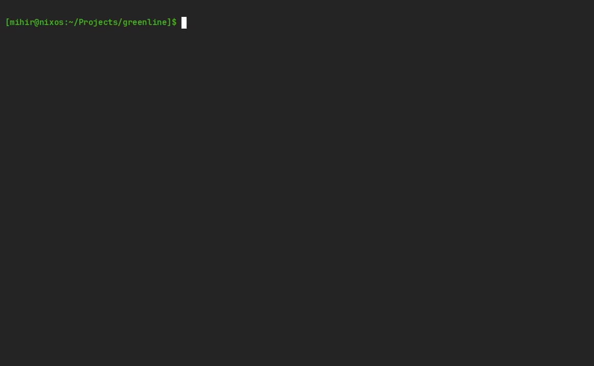

# Greenline
A lightweight keyboard-driven TUI for monitoring and overclocking your NVIDIA
GPU on Linux.



## Features
- Monitor GPU utilization, VRAM, temps, fan, power, throttling, and more
- Configurable plots to graph metrics over time
- Overclock core/memory speeds and adjust power limits*
- Toggle manual fan overrides*

*Requires root; the GPU driver intentionally requires this. Run with `sudo
greenline`.

> [!WARNING]
Overclocking is risky, make sure you know what you're doing. Start
conservative, change one variable at a time, and carefully monitor temps and
fan speed. It is very difficult to cause permanent damage, but very easy to
bring about system instability, screen freezes, driver crashes, or reduced
hardware lifespan. I take no responsibility for hardware damage.

## Installation
Greenline is built for x86-64 Linux (glibc ≥ 2.34). It supports consumer NVIDIA
GPUs with an architecture of Maxwell or higher. It depends on the NVML library
which is only included with the proprietary NVIDIA drivers.

Nix:
```bash
nix run github:mpatankar6/greenline
# Add it as an input to your system flake, or alternatively,
nix profile install github:mpatankar6/greenline
```

AUR:
```bash
# WIP
# paru -S greenline
```

For other distros, tarballs can be found in [Releases](../../releases).

## Building
### Dependencies
**With Nix:** Use the dev shell; it handles dependencies and the NVML library
path on NixOS. Loads automatically with direnv, or run `nix develop`.

**Otherwise:** A Clang or GCC version with good C23 support. You'll need CMake,
Ninja, and pkg-config to build. With pkg-config, check you have the required 
dependencies:
```bash
pkg-config --exists nvidia-ml ncursesw && echo "found" || echo "missing"
```
nvidia-ml likely comes from your distro's CUDA package.

### Development
```sh
cmake -B build -G Ninja -DCMAKE_BUILD_TYPE=Debug
cmake --build build
cmake --build build --target analyze # Optional
run-clang-tidy -quiet -p build       # Optional
```
Development builds run with ASan and UBSan.

### Testing
To run unit tests after building:
```sh
ctest --test-dir build --output-on-failure
```

### Release
With Nix:
```sh
nix build
nix profile install . # Optionally install to Nix profile
```

Otherwise:
```sh
cmake -B build -G Ninja -DCMAKE_BUILD_TYPE=Release
cmake --build build
sudo cmake --install build # Optionally install to /usr/local/bin
```

## Limitation
- Support for non-NVIDIA GPUs
    - We would need an alternative implementation of `gpu.c` for AMD, Apple,
      Intel, etc. Then it can be subbed in at link time. Problem is I don't
      have the hardware to test. I'm open to contributions though.
- No fan curves
    - [LACT](https://github.com/ilya-zlobintsev/LACT) is a good program for
      this.
- Process management
    - [nvtop](https://github.com/Syllo/nvtop) can do this.

Settings need to be reapplied after a reboot. This is somewhat by design, since
the lack of startup service means a reboot always returns the GPU to stock.

## TODO
- [ ] Rewrite in Rust

## License
Copyright (C) 2026 Mihir Patankar

This project is licensed under the GNU General Public License v3.0 or later -
see the [LICENSE](LICENSE) file for details.
